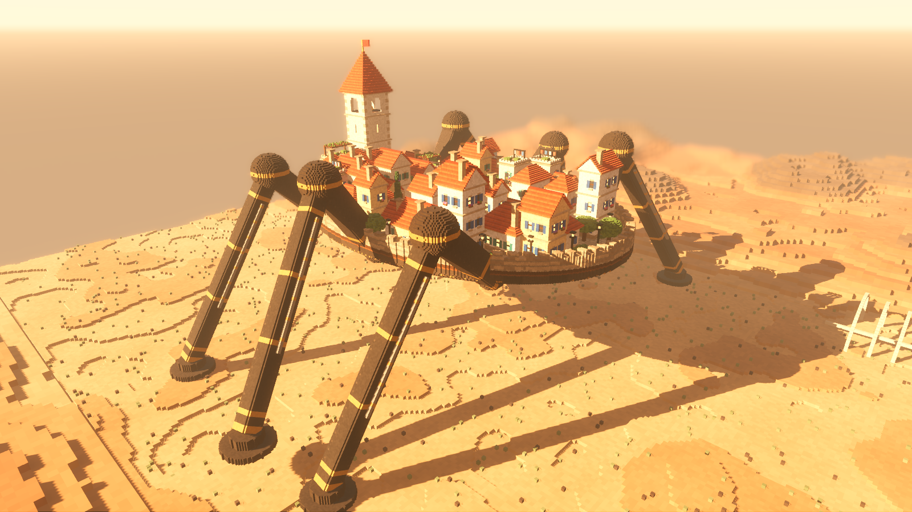

# Strider Home *(working title)*

You're one ordinary resident of a small **walking city** crossing a dangerous wasteland. Live your life on its swaying deck, help keep it going, and be there when the big threat finally comes.

A hobby game for me and my friends, made with Claude Code in **Godot 4.7**.

*Early look test: everything here is built from code, with no image files. Not final art.*

## Status

You live on a walking city: walk it in first person, visit the guild, tavern, store, bathhouse and workshop, talk to eight named residents, and live through a day from dawn until the city kneels for the night. Current milestone: **"A day in town"** (combat is parked for now). Details: **[docs/STATUS.md](docs/STATUS.md)**.

## Run it

- **The game:** double-click `game/run.bat`. It starts with **the morning round**: Mira asks you to help Pip with his deliveries, a guided walk round the town and its people (about 10 minutes; `WELCOME_ROUND` in `game/tuning.gd` turns it off). Click in the window, then the mouse looks around. WASD or arrows walk, Shift runs, E uses, and the mouse wheel zooms (all the way in = first person). F2 flags something that felt off, F3 shows debug info, F4 opens the sound board, F5 the mood and lighting panel, F6 switches to low quality (for the laptop; `run_low.bat` starts in it), T jumps an hour ahead, and Esc frees the mouse (press it again to quit). Every play session is recorded to `game/playtests/` for Claude to study.
- **Look test:** install [Godot 4.7.2](https://godotengine.org) (`winget install GodotEngine.GodotEngine`), then double-click `prototypes/look_test_hd/run.bat` (older coarse version: `prototypes/look_test/`).
  Keys: `1`–`6` camera, `Space` pause, `Esc` quit.

## What's where

| Path | What |
|---|---|
| `CLAUDE.md` | How we work together (read automatically by Claude Code) |
| `docs/STATUS.md` | **Start here:** where we left off, open questions, setup per machine |
| `docs/GAME.md` | The game on one page |
| `docs/TASTE.md` | What I seem to want (Claude's read) |
| `docs/IDEAS.md` | Every idea, used or parked |
| `docs/DECISIONS.md` | What we chose, why, and who chose it |
| `docs/PITCHES.md` | The three concepts we chose between |
| `docs/history/` | Past conversations, kept for context |
| `docs/screens/` | Screenshots worth keeping |
| `game/` | **The game.** Tuning numbers: `game/tuning.gd`. The world's code is in `game/world/` (see `docs/ARCHITECTURE.md`) |
| `game/audio/` | Recorded sounds, their credits, and your sound board settings |
| `docs/ARCHITECTURE.md` | How the code is organised, and the rules for keeping it clean |
| `prototypes/` | Throwaway experiments (look tests) |
| `tools/` | Helper scripts: `run_tests.ps1` (all tests), `godot_offscreen.ps1` (hidden runs), `to_jpg.gd`, `transcript_to_md.py` |
