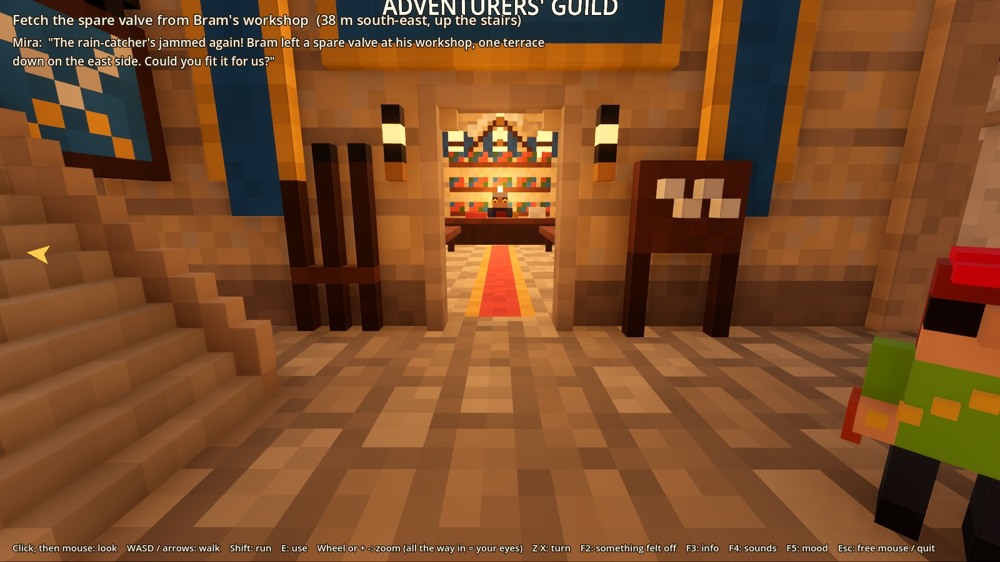
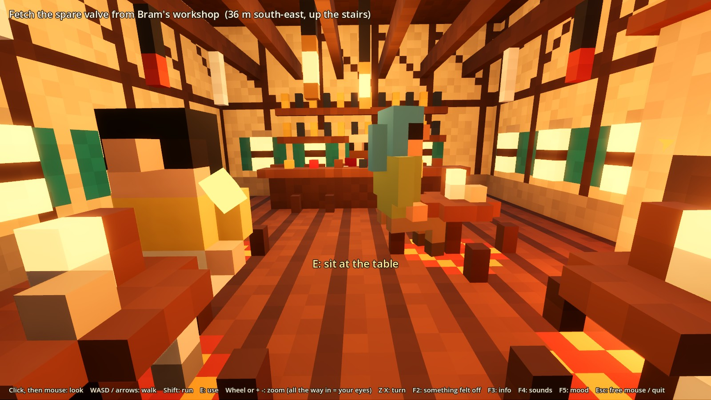
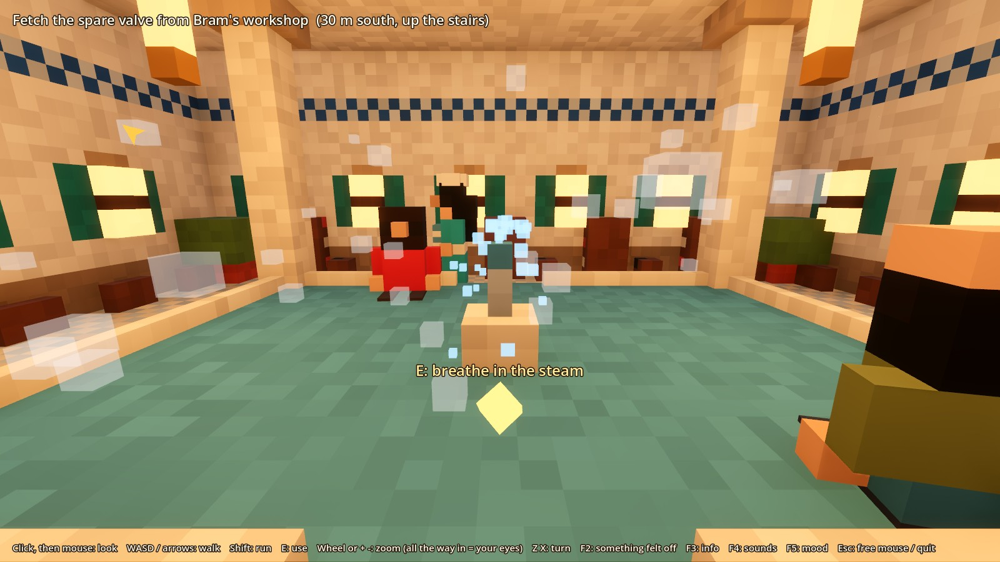
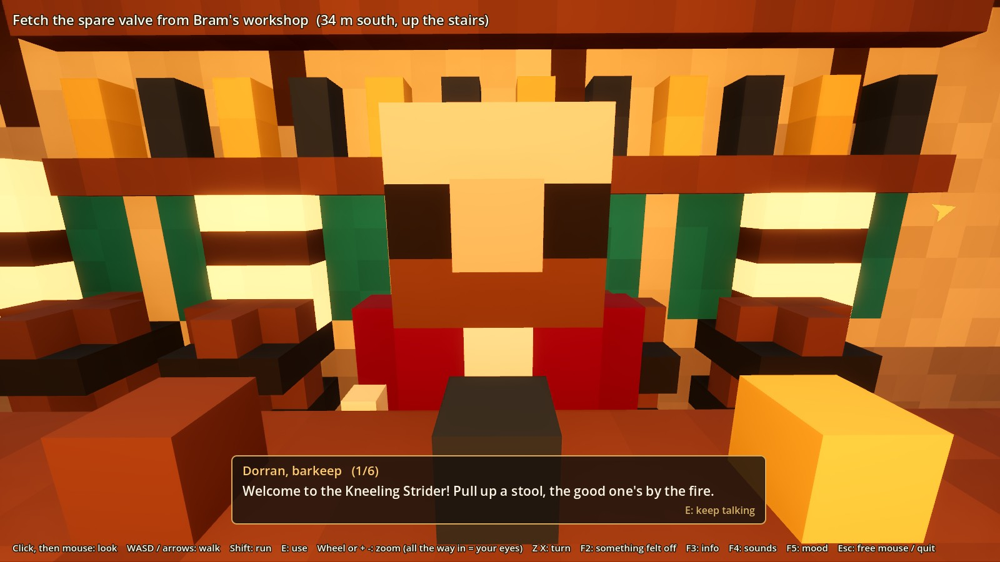
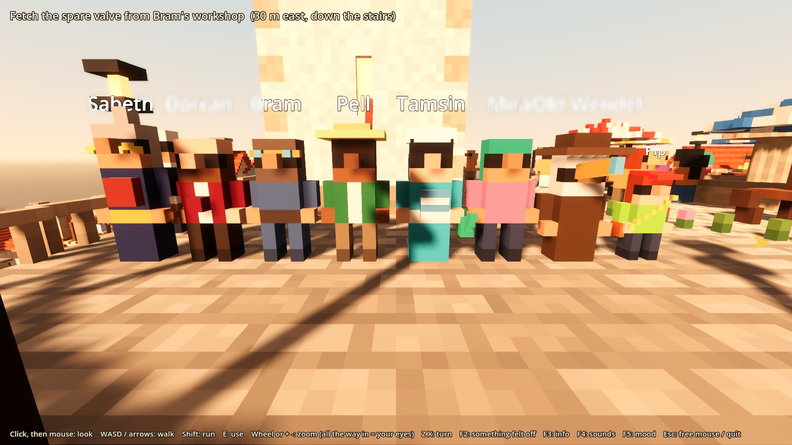
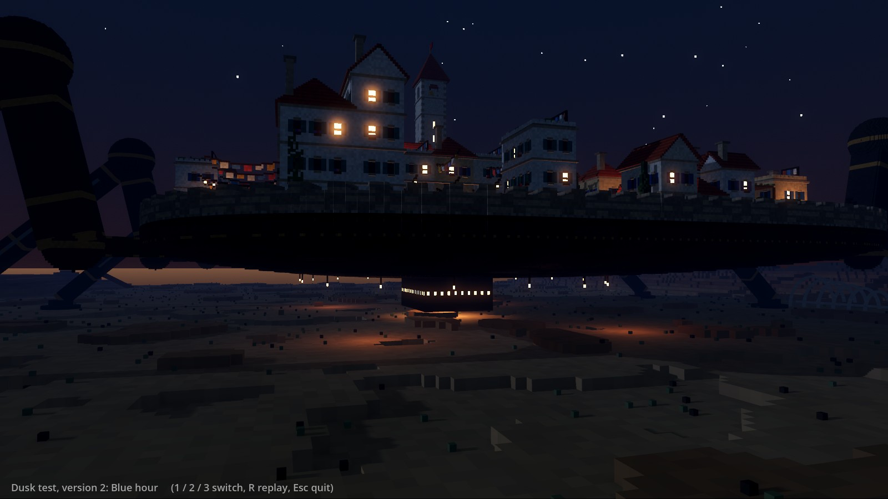

# STATUS: start here

**New session? Read this first**, then `docs/TASTE.md`, `docs/GAME.md` and the end of `docs/DECISIONS.md` (as `CLAUDE.md` says). For the user's own words and reactions, read `docs/history/` (session 04 is the latest: `session-04-review-and-a-day-in-town.md`).

_Last updated: 2026-10-28, home PC after session 04: pulled the laptop's work, reviewed "A day in town" (all 15 test groups pass here, day screenshots look right on the RX 7900 XTX) and fixed the review's 4 small things: residents make way for you every time you step in front, not just once a trip (new "make way" test, 16 groups); the route search can't read off the map's edge; a stray tab; `_sphere` moved to `legs.gd` so `blocks.gd` is under 600 lines. The local copies of the 7 deleted branches are still on the home PC (deleting them needs the user; see Next session). Before that, session 04 (work laptop): a review of everything and its fixes; the user parked combat and chose town life; `tidy`, `laptop-speed`, `bug-hunt` and `dusk` merged into `main`; **"A day in town" step 1 built** (see "Session 04" below); 7 old side branches deleted; **everything pushed to GitHub** (main, `combat-toys`, `city-10x`). Before that, 2026-10-27, the long night at the end of session 03 (home PC): five walk-in buildings and eight named residents, a dusk look test, a bug hunt, a laptop speed setting and a tidy-up, all on branches (part 2 below). Before that, overnight: new recorded sounds, two combat toys, a polish pass. Session 03 before that: home PC check, the market street (merged), the sound board (F4), the mood panel (F5), and the world code split into layers (see `docs/ARCHITECTURE.md`)._

## ➡️ Next session (on either machine)

1. `git pull` on `main`, then `git fetch --prune`. Only two side branches are left: `experiment/combat-toys` and `experiment/city-10x`. **On the home PC (first time after 2026-10-28):** delete the local copies of the 7 deleted branches, if they're there: `git branch -D experiment/tidy experiment/dusk experiment/laptop-speed experiment/bug-hunt experiment/facilities experiment/polish-01 experiment/market-street`. Everything in them is on `main`.
2. **Docs live on `main` only.** The copies of `docs/` on the two side branches are older (each has a ⚠️ banner saying so); when you're on a branch, read `git show main:docs/STATUS.md`. **If `combat-toys` is ever merged, keep `main`'s living docs** (never bring in the banner or the old text).
3. **Ask how the day felt** (see "Session 04" below): did they play a full day, what part they liked, what bugged them. Then step 2 of "A day in town" (the guild board with 3 everyday jobs). Only `experiment/combat-toys` is still unmerged (parked).
4. **Review of everything (2026-10-27, work laptop): `docs/REVIEW-2026-10-27.md`.** **The fixes are done** (same day) and are all on `main` now, except the combat toy fixes, which are on `experiment/combat-toys`. Still open: the cleanups, M6 and S1/S2. **Ask the user to check by hand:** closing F4/F5 gives mouse-look back (can't be tested hidden); the market crowd loop for a click; sitting in first person and with the valve looks right.
5. Claude's private memory notes stay on the machine they were written on; the rules that matter are in "Important rules learned" below.

## Session 04 (work laptop, 2026-10-27/28): "A day in town", step 1

**What happened, in order:**
1. **2026-10-27:** pulled session 03's work; measured low quality on the laptop (about 2x faster, numbers in part 2, item 5 below).
2. The user asked for **a review of everything**: `docs/REVIEW-2026-10-27.md`. About 20 bugs the tests missed.
3. The user: **"fix all the player-visible bugs and the broken tests, on each branch; leave the cleanups for later."** Done, each fix with a test.
4. **2026-10-28:** the user came back after a break. They **didn't feel like combat** and wanted another focus; from Claude's 4 options they picked **town life**. Combat is parked (second time; see TASTE).
5. The user said **"Yes, build it"** to Claude's draft milestone **"A day in town"** with all defaults. Claude merged `tidy`, `laptop-speed`, `bug-hunt` and `dusk` into `main`, then built step 1 (below), checked by two critic rounds.
6. The user asked to **push** main and then the side branches, then to **delete the 7 side branches** that `main` already covered. Only `combat-toys` and `city-10x` remain.
7. The conversation is saved in `docs/history/session-04-review-and-a-day-in-town.md`.

**The user hasn't played the day yet.** That's the first thing to ask about next session.

**What's on `main` now:** the new town and residents (`tidy`), F6 low quality (`laptop-speed`), the walkabout bot (`bug-hunt`), the dusk scene (`dusk`), and the day:
- **The clock:** 7:00 → 19:00 in 20 real minutes, starting at 8:00. "Day 1 · 8:30" in the top right (and in F3). **T** jumps an hour. Tuning: `DAY_MINUTES`, `DAY_START_HOUR`, `EVENING_GLOW`, `EVENING_LAMPS` in `game/tuning.gd`.
- **The light follows the clock:** Dawn (7:00) → Soft morning (8:30) → Midday (12:00) → Golden hour, or your saved F5 look (16:00) → Dusk (18:30) → Nightfall (19:00). Touching F5 pins the look; "Follow the day" gives it back.
- **The town's timetable** (`game/town_data.gd`): `OPEN_HOURS` (store and guild 8-17, tavern 11-19, bathhouse 9-19, workshop 7-18), `CLOSED_LINES`, `ROUTINES` (who goes where when, see `CHARACTERS.md`), and `MARKET_CROWD` (empty at 7:00, full 11:30-16:00, empty by 19:00). OPEN/CLOSED plaques by each door. Doors never lock.
- **Evening:** lamps brighten from about 17:30; bell at 18:00; the market empties; the city slows to a stop by 18:45 and kneels by 19:00. Then a fade, "Day 1 done", Day 2 at 7:00 with a morning bell; the city stands by 7:15 and walks by 7:30.
- **Tests:** a new "day" group (15 groups then; 16 with "make way", added on the home PC), about 10 minutes on the laptop. Tests that need the whole town at work start at 14:00 with the clock stopped (`-- --hour 14 --freeze-clock`).
- **Screenshots:** `game/tests/day_shots.tscn` (hidden: `tools/godot_offscreen.ps1 game --fixed-fps 30 res://tests/day_shots.tscn '--' --no-record`). Keepers: `docs/screens/2026-10-28_day_*.jpg` (7:07 city, noon market, 16:00 city, 18:58 market, city and tavern, the end card).
- **Critic (separate agent), two rounds:** fixed: morning looked like noon (new Dawn look), the plaques were easy to miss (OPEN is now green), the market screenshot was blocked. The city and market read clearly from 7:00 to 19:00. **Still weak:** standing at a shop door, nightfall looks much like dawn, because the indoor lights shine through walls onto the doorstep (a real fix needs shadows on those lights: too slow for the laptop).

**For the user to check by hand (Claude can't):**
- Both bells (18:00 and the morning) are audible, and the market crowd fades in the evening.
- Play a whole day: `game/run_low.bat` on the laptop, T to hurry. Talk to Sabeth at about 7:40 (before the guild opens); watch Pell walk to the tavern at 17:00.
- From the review: closing F4/F5 gives mouse-look back; the crowd loop for a click; sitting in first person.

**Known and parked:** Mira's speech bubble can be seen from far away (huge from the desert; only matters once we go down there); the top-left quest text can sit over building signs in first person; the miniature blur makes a soft blob at the far end of the market street; thin bright slivers between blocks on the dark sand at nightfall.

## 🌅 Morning report, part 2 (the long night, 2026-10-27)

After the first report, the user asked Claude to keep going all night, decide things on its own, and review everything with matched critics. **Everything is on branches; nothing new is on `main` except docs.** *(History: all of it was merged into `main` on 2026-10-28, except the combat toys, and the branches were deleted.)*

### Look first

| | |
|---|---|
|  The Adventurers' Guild |  Inside the Kneeling Strider |
|  Inside the bathhouse (steam, pool seats) |  Talking to Dorran (E) |
|  The eight named residents |  Dusk test: knelt, lift down, lamps lit |

More in `docs/screens/2026-10-27_town_*.jpg` and `..._dusk_*.jpg`.

### Things I decided quietly that touch the big picture (overrule any)
- **The city kneels and lowers a cargo lift at dusk** (dusk test). That's a guess at how expeditions start, not a decision.
- **Glowing eyes in the dark desert and "sand-crawlers" in people's talk** hint at what's out there. Flavour only; the real enemies are your call.
- **Sabeth's "bottom of the ledger"** line hints that the guild has ranks. Also flavour; no rank system exists.
- Where the buildings stand (they replace ~15% of the homes on that side), all names, looks and lines, the tavern's name ("the Kneeling Strider").

### 1. The town's places and people (branch `experiment/tidy`)
- **Five walk-in places** round the foot of the stairs on the homes side (the workshop stays on the middle terrace): **the Adventurers' Guild** (request board, notices, a beetle-horn trophy, long tables), **the Kneeling Strider tavern** (bar, hearth, regulars), **Pell's Provisions**, **the Bathhouse** (a pool you wade into and sit in, steam, a fountain), and **Bram's workshop**, now furnished. Each has a sign, a hanging picture sign, lamps and people.
- **Eight named residents** with their own look, prop, habit and 4-7 lines each (`docs/CHARACTERS.md`). Their talk changes after Mira's errand.
- **E does things now:** talk (lines cycle, "2/4"), read boards, sit on stools, benches or in the bath, look at things. A small gold diamond shows what E will use.
- **Critics (first draft → after fixes):** outsides: guild 5→7, tavern 7→8, bath 4→7, store 6→6, workshop 5→5. Insides: tavern 7→8, guild 5→6.5, bath 4→6, store 5→5.5, workshop 3→4. Layout 8-9. Interactions: clarity 7→8, feedback 6→8. Spoiler guard: clean.
- **Weakest spots (honest):** the workshop is still the plainest (tiny, flat red roof); the store's inside is a bit bland.
- **Code reviewer:** found 8 things, all fixed: one press of E could pick up the valve *and* talk to Bram; sitting down while walking stood you straight back up; boards and seats worked through walls; the buildings test didn't check that each press did something; the cast's randomness reshuffled the crowd; reach and text times were hard-coded (now in `tuning.gd`); one file was over 600 lines (now split); small comment fixes. A new test guards the first two.
- **Tests:** all 10 groups pass. A bot walks into all 5 places and uses all 15 things. No slowdown (about 310-470 FPS).

### 2. Dusk (branch `experiment/dusk`; double-click `game/dusk.bat`, keys 1 / 2 / 3, R replays)
- A 48-second scene to watch: the city walks into the sunset, slows, kneels, lowers its cargo lift and lights its lamps; night falls with stars, and eyes open in the dark.
- Three versions: Ember, **Blue hour** (the critic's pick, 8/8 for mood and "safe home in a dangerous world"), Dust.
- Not done: more lit windows at night; frame the city larger in the last shot.

### 3. Bug hunt (branch `experiment/bug-hunt`)
- A bot walked all over the city for an hour of game time (7.9 km): **no stuck spots, falls or height glitches.** A 5-minute version joins the tests.

### 4. Polish round 2 (branch `experiment/polish-01`, already inside `tidy`)
- A mouth on faces; market groups stand in looser clusters.

### 5. Laptop speed (branch `experiment/laptop-speed`; `game/run_low.bat`, or F6 in the game)
- Lower 3D resolution with sharp upscaling, no soft extras, simpler shadows, shorter view, distant people hidden.
- **On this PC: 40-80% faster.** **On the laptop (measured 2026-10-27, `game/tests/fps_check.tscn`, hidden run): about 2x.** High → low FPS: plaza 16-18 → 36-39, market street 19-20 → 38, guild row 13 → 22-24 (the guild row is the heaviest spot). Low makes the laptop comfortably playable except near the guild row. Not yet judged by eye: whether low looks acceptable.

### 6. Tidy-up (branch `experiment/tidy`)
- The world code is now 13 layer files, none over 600 lines. Proved to build the same world, and all tests pass.

### How to try them
- All of these are on `main` now (merged 2026-10-28, their branches deleted). Double-click `game/run.bat`, `run_low.bat` or `dusk.bat`.
- **Merging:** say which ones you like and I'll merge them in order.

**Questions for the user (pick one or two):** which building do you walk into first, and what part of it do you like? Blue hour, Ember or Dust? Then the combat toys are still waiting.

## 🌅 Morning report, part 1 (overnight, 2026-10-27)

The user went to sleep and asked Claude to work through the night: **sounds, then two combat toys, then a polish pass** (all defaults accepted). Nothing was merged into `main` except the sounds; nothing was decided for the user.

1. **Sounds (on `main`):** the user's 7 Freesound downloads are in: desert wind, town life, a real bell, and 4 creaks. Originals are kept in `audio_originals/` (not in git); `tools/prepare_sounds.py` made small, seamless game copies. New: **the city creaks and groans** as it steps, and **town life** plays away from the market. All tests pass. **Needs the user's ears:** F4 to balance (Claude can't hear).
2. **Combat toys (branch `experiment/combat-toys`, `prototypes/combat_toys/run.bat`):** a menu, then the same night desert and dune beetle, fought two ways. **1 = action** (WASD, Space roll, click strike; read its wind-ups, punish it while stuck). **2 = turn-based** (You and Bram share a hand of cards; the beetle shows what, at whom and *when*). Bot tests: a smart bot beats both; standing still or playing at random loses. A separate critic scored them (readability / looks / impact): action 6/5/6, turn-based 8/6/3, and its top issues were fixed (darker-than-night beetle, too-strong hit flash, overlapping numbers, a floating horn, camera, end screens). **Not re-scored after the fixes.** Not felt by a human yet: only the user can say which is fun.
3. **Polish (branch `experiment/polish-01`):** residents now come in many builds (heights, dresses, aprons, hair styles, beards, headscarves), and the default golden hour is softer (less glare); the old light is the F5 preset "Golden hour (strong)". A separate critic compared before and after (people 4 → 6, light 5 → 6.5, overall 5.5 → 6.5; burned-out white pixels dropped from ~8–10% to 0–2%). A second round from its notes: anyone within 1.3 m of the camera is hidden (no more giant torsos in first person), faces have a nose, long hair narrows down the back, a little less haze. **Its next ideas, not done:** small brows/neck on heads, crisper colours in the bird's-eye view, crowds standing less in queues. Before/after: `docs/screens/2026-10-27_polish_*.jpg`.

**To try them:** see "Branches" below. **Questions for the user:** which combat toy do you want more of (and *what part* of it)? Keep the polish? How do the new sounds feel?

## Where we are

- ✅ **Phase 1: Discover**: done. Three core desires confirmed (see TASTE.md).
- ✅ **Phase 2: Pick a direction**: done. **"Strider Home"**: you're one resident of a walking city crossing a dangerous wasteland.
- ✅ **Phase 3: First playable toy**: done. `game/` is the terraced city: you walk it (first person or behind you), it walks and sways, there are 50 neighbours, and Mira's errand (valve from Bram's workshop to the rain-catcher). Playtested 3 times, with fixes after each.
- ➡️ **Phase 4: Grow it**: the user reshaped the core loop (see GAME.md): day in town (shops, guild, requests), dangerous night expeditions with combat, then race home at dawn. **The next milestone isn't locked: it waits on the combat-style decision.**
- 🌙 **The long night (end of session 03, home PC):** the user let Claude work alone with its own decisions. Built on branches, nothing merged: five walk-in buildings and eight named residents (`experiment/tidy`), a dusk look test (`experiment/dusk`), a bug hunt (`experiment/bug-hunt`), a laptop speed setting (`experiment/laptop-speed`), plus code review fixes and a tidy-up. See morning report part 2.
- 🧪 **Session 03 (home PC):** the user said the city feels too small and the paths cramped, and that a big city means "crowds and bustle". So we built the **Market Street test**; the user liked it, and it's **merged into `main`**. Then: the flag key moved to F2; sound decided (free recorded CC0); the **sound board (F4)** and **mood and lighting panel (F5)** were built; `world.gd` was **split into 9 layer files** (proved identical); and two stairs bugs were found and fixed (a shop on the north stairs, eaves over the east stairs).

### What session 02 did (short)
Code review and fixes; tests run hidden (`tools/godot_offscreen.ps1`); a 2.5x faster mesher; the terraced city; a 10x experiment (branch `experiment/city-10x`, parked); the first playable toy; playtest tools (recorder, F8, exact replay, F3); 3 playtests; first person.

## Open questions for the user (ask one or two at a time)

0. **Sound: recordings are in (session 03 + overnight), waiting for the user to listen.** Overnight added: desert wind, town life, bell, creaks (see the morning report). `game/audio/` holds 30 CC0 recordings (credits in `game/audio/CREDITS.md`): footsteps in 3 sets (`stone`, the default; `wood`; `rpg`), coins, crates, and 3 market crowd recordings (France, the default; Sofia; London). The user plays, opens the sound board (F4), picks favourites, sets volumes and presses Save. **Ask how they sound.** Claude can't hear: watch for "too loud", "too quiet", "the loop jumps" (the crowd files are 2–3 minute recordings that restart).

1. **Parked (2026-10-28, the user's call): combat.** The toys stay on `experiment/combat-toys` (fixed) for later; don't push it. When it returns: **play the two toys** (built overnight, branch `experiment/combat-toys`). Then ask "what part?" of the one they liked. The user postponed this at the end of session 02. Options: (a) action, real time; (b) turn-based tactics like Chrono Ark (a game they love; it makes AI companions easy); (c) real time with pause to order the party. Ask "what part?" (the rush of reflexes, a clever plan, or the party's spectacle). *Claude's suggestion: two tiny combat toys on a branch (an afternoon each), one action and one turn-based, against the same desert creature. Let the user play both and react.*
2. **Companions:** the user wants a party of AI companions (neighbours, guild members). *Claude's lean: the first expedition solo, then one simple companion who follows, talks, carries and warns at dawn (no fighting), and fighting companions once combat exists.* Not confirmed.
3. **Fail state when stranded:** the user said "catch up on a vehicle, or game over and reload." *Claude suggested softer (a caravan rescues you, you lose your haul) and no vehicles in the first version (a sprint on foot after the rising city).* Not confirmed.
4. ~~**Which facilities first**~~ A first pass of all five (guild, tavern, store, bathhouse, workshop) was built in the long night, on `main` since 2026-10-28. **Ask:** which one the user walks into first, and what part they like. Real shops, quests and ranks are still the user's call.
5. *(Low priority)* **Nano Banana Pro access** for concept art: the Gemini app or an API key? Only matters once we do concept art.

## Suggested next step

**Focus (2026-10-28, the user's pick): town life.** Combat is parked. **Milestone "A day in town" is locked** (the user said "Yes, build it" to all defaults). Step 1 (the merges, the clock, light, routines, hours, evening) is built: **the user plays it first.** Step 2: a guild board with 3 everyday jobs like Mira's errand (no money). Out: combat, expeditions, money and real buying, saving, homes, night. The older draft, "One night out", waits until combat comes back.

## Important rules learned (don't break these)

- **It has to look good.** That's the user's #1 fear from past projects. Keep art code-built and consistent, and use screenshots plus a **separate critic** pass on visuals.
- **The user lives at street level.** They play in first person most of the time (69% in playtest 3). Judge things at human scale: door sizes, things in the way, what you see from your own eyes.
- **"Bigger city" means more places with a purpose** (confirmed), not more area. Never grow the city by repeating the same houses.
- **Never show the user story spoilers.** The payoff is gameplay-first, with a short story checked by blind critic agents ("predict the twist" and "find the clues" tests). The user judges it only by playing blind.
- **Living world = the clever fake:** residents with routines and reactions, not deep AI.
- Don't build Huge things. Ask before paid tools.
- **Tests run hidden.** The game must never pop up on the user's screen or grab their mouse and keyboard while Claude tests. Use `tools/godot_offscreen.ps1`, or `--headless` for logic. Open a visible window only when the user asks to see it.
- **Read `docs/ARCHITECTURE.md` before changing code, and follow its rules** (one job per file, layers only use what's below them, `_seed("part")` per build part, game rules separate from visuals, a test per system).
- **After every change to `game/`, run `tools/run_tests.ps1`.** When a test fails after a change, check whether the test or the game is wrong before "fixing" either.
- **Playtests are the main feedback loop.** The user plays and presses F2 (was F8 until session 03); Claude reads the logs, replays the session to see the flagged moments, fixes, and proves the fix with a test that reproduces the user's exact situation.
- **When the user hands over decisions (e.g. an overnight run):** decide freely within the agreed plan, but keep it reversible: branches only, nothing merged into `main` without the user, every decision logged in DECISIONS as Claude's. Still the user's: core direction and open design questions (combat style, companions, fail state, story), paid tools or new accounts, downloads not already agreed, deleting their work, anything public. Stop when the plan is done; new ideas go to IDEAS.
- **Refactor checks:** the world fingerprint is only repeatable with `--fixed-fps 20` (people's positions depend on frame timing otherwise).
- **Save only the conversation to `docs/history/`** (`--chat-only`): the user wants later sessions to read between the lines, not the commands.

## Art status

- **The game (`game/world/`) is now the reference for the look.** It's the terraced city from the look test, plus: legs attached outside the deck on struts, 2.4 m doors, lamps off the main streets, wade-through plaza flowers, Bram's workshop and the rain-catcher.
- **Look tests (frozen, for comparison):** `prototypes/look_test_hd/` (flat, 20 cm blocks), `prototypes/look_test_terraced/`, `prototypes/look_test/` (coarse). Critic scores (terraced vs flat): appeal 7 vs 8, Town to City look 6 vs 8, streets to wander 6 vs 4, awe from outside 7.5 vs 5.5, bustle 6.5 vs 4.5.
- **Art polish list for later** (from critics): denser rows of houses with shared walls; lanes and arched gates through the terraces; walls with buttresses, niches and windows; stalls round the plaza; taller blocks stepping up to the tower; more detail on the legs and the hull underside.
- **Screens worth a look:** `docs/screens/2026-10-26_toy_fp_*.jpg` (first person), `..._toy_*.jpg`, `..._city_scale_comparison.jpg`, `..._flat_vs_terraced.jpg`.
- Idea for later: Nano Banana Pro concept art → Claude rebuilds it in code (technique C8).

## Machines

| | Home PC (main) | Work laptop |
|---|---|---|
| Use for | Everything: building, running, screenshots, art | Session 02 happened here. Design, docs, code, tests, playtests. |
| GPU | AMD RX 7900 XTX (24 GB) | Intel Iris Xe, much weaker: the game runs at ~20–28 FPS. **Design for the home PC**, as the user asked. |
| Godot | 4.7.2 via winget: `%LOCALAPPDATA%\Microsoft\WinGet\Packages\GodotEngine.GodotEngine_Microsoft.Winget.Source_8wekyb3d8bbwe\Godot_v4.7.2-stable_win64_console.exe` | Same version and path (installed) |
| Python | `py -3` (plain `python` hits the Microsoft Store stub) | `py -3`, with Pillow |
| Other | Blender 4.5, Krita 5.2, Node, VS Code | Git and Claude Code |

### Home PC check after session 02 (done 2026-10-26, session 03)

1. ✅ Pulled. ✅ Git now uses the noreply address on the home PC too.
2. ✅ All 5 test groups pass (bot errand done in 42 s of play).
3. ✅ `tools/godot_offscreen.ps1` works on the AMD card: the bot errand with 7 screenshots in 12 s.
   - **Gotcha:** when you call the script from *inside* PowerShell (`& .\tools\godot_offscreen.ps1 ...`), PowerShell eats a bare `--`, so the game never sees `--autoplay` or `--shots` and it just times out. Quote it: `'--'`. With `powershell -File ...` a bare `--` is fine.
   - Claude's auto mode on the home PC refuses `powershell -ExecutionPolicy Bypass -File ...`. Inside the PowerShell tool, the process policy is already Bypass, so call the scripts directly with `&`, or run the Godot commands from `run_tests.ps1` one by one.
4. ✅ **Speed on the home PC (RX 7900 XTX):** the toy runs at **~440 FPS** uncapped (laptop: 25). **The 10x city runs at ~80–95 FPS** (laptop: 6), and building it takes ~25 s at start. So on the home PC, a much bigger city is affordable; the laptop is the limit, and startup time is the main cost.
5. ✅ The user played at home (112 s, errand done, 240 FPS, 72% first person): "runs much better than on the laptop", "the city looks bigger than in screenshots but still feels too small", **"the paths to get around are very narrow."** Measured: 40% of path length under 2 m, 75% under 3 m, ~3,000 m² walkable. Answered: the narrow paths feel cramped and are a bit hard to walk; it doesn't feel like walking a real city (Tokyo). The user floated a real-city size with buses (Claude: Huge; suggested districts joined by a tram). **What part of Tokyo: "crowds and bustle: lots of people, shops, signs and life everywhere."** Claude proposed a **Market Street test** (see the session 03 history / DECISIONS once agreed): one wide, busy shopping street, walkable in first person.
6. **Repo visibility:** session 02's docs say the repo is public, but from the home PC an anonymous visit gets a 404, so it's **private**. Keeping the noreply email and the history scrubbing does no harm. Ask the user whether they made it public for a while.

### Setting up another machine (one time)

1. Install **Git for Windows** (it includes Git Credential Manager), **Claude Code** and **Godot 4.7.2** (`winget install GodotEngine.GodotEngine`).
2. Clone: `git clone https://github.com/teetuuhobby-wq/Game01.git`
3. Set the git name and email as in step 2 above. Older commits keep the old address; rewriting history isn't worth it.
4. The first `git push` opens a browser window to sign in to GitHub. Approve it once, and it's remembered after that.
5. If a push is rejected ("fetch first"), the other computer pushed newer work. Run `git pull`, then push again.

## How to run things

- **Play the game:** double-click `game/run.bat`. Click in the window, then the mouse looks around. WASD or arrows walk, Shift runs, E uses, the mouse wheel or + - zooms (all the way in = first person), Z X turn. F2 = "that felt off", F3 = debug info. Esc frees the mouse; Esc again quits. Tuning numbers: `game/tuning.gd`.
- **All tests (Claude, after every change):** `& .\tools\run_tests.ps1` from PowerShell. Headless, 16 groups, about 10 minutes on the laptop (the walkabout and the day take longest). Exit code 0 = all passed. The list with what each test checks is at the top of the script.
- **Hidden runs with pictures:** `powershell -NoProfile -ExecutionPolicy Bypass -File tools/godot_offscreen.ps1 <project_dir> [godot args] [-- game args]`. Godot runs on a separate, never-shown Windows desktop with sound off; screenshots and FPS match a visible run. Add `--fixed-fps 60` for repeatable screenshots. It stops at once if a script fails to load.
  - Bot errand with screenshots: `... godot_offscreen.ps1 game --fixed-fps 30 -- --autoplay --shots` (into `game/shots/`).
- **Playtests (recorded automatically):** every normal play session writes `game/playtests/<date_time>/`. It's git-ignored, so it stays on the machine it was played on.
  - `events.csv`: start here. The user's **F2 flags** with notes and a screenshot (`flag_NN.png`), plus automatic flags: `stuck`, `camera_jump`, `low_fps`, errand steps.
  - `log.csv`: 10 times a second: position, floor, camera (zoom; negative = first person), FPS, errand step.
  - `inputs.csv`: every frame's keys and mouse, for replay.
  - `session.txt`: machine, tuning values, and the **game version (git commit)**.
- **After a playtest (Claude):** read `events.csv` and `log.csv`, then replay hidden to *see* the flagged moments:
  `... godot_offscreen.ps1 game --fixed-fps 60 -- --replay playtests/<folder> --shots` (shots into `<folder>/replay/`). Replays only match the game version they were recorded on. If the code has changed since, replay from a copy of that commit: `git archive <commit> game`, extract it, copy the playtest folder into its `game/playtests/`, and run from there.
- **Look tests:** `prototypes/*/run.bat` (keys 1–6 camera). Screenshots: `... godot_offscreen.ps1 prototypes/look_test_hd -- --shots`.
- **Screenshot rule:** every `shots/` folder is git-ignored. Save keepers to `docs/screens/` as **JPG**: `<godot_console.exe> --headless --script tools/to_jpg.gd -- <shot.png> docs/screens/YYYY-MM-DD_topic.jpg`.

## Branches

| Branch | What it is | Status |
|---|---|---|
| `main` | The project. Always work here. Has everything from the old `tidy`, `dusk`, `laptop-speed`, `bug-hunt`, `facilities`, `polish-01` and `market-street` branches. | Active |
| `experiment/combat-toys` | **The two combat toys** (overnight, 2026-10-27): `prototypes/combat_toys/`. Double-click its `run.bat`, pick 1 (action) or 2 (turn-based). Review fixes applied 2026-10-27. Doesn't touch the game. | **Parked** (the user's call, 2026-10-28) |
| `experiment/city-10x` | **Look only, don't merge.** The terraced city at 10x its area (265 x 177 m, 4 terraces, 736 houses), built because the user asked to *see* the real scale. Code: `prototypes/look_test_10x/`. 6 FPS and a 33 s start on the laptop, 2.7 GB of memory. | Parked. The user later said even 10x may not be big enough, but what they mean is more *places with a purpose* (see TASTE). |

**Only two side branches are left** (the user deleted the other 7 on 2026-10-28; everything in them was already on `main`).

To look at the 10x city: `git fetch`, `git switch experiment/city-10x`, double-click `prototypes/look_test_10x/run.bat`, then `git switch main`. Commit or stash any work first. The same goes for the combat toys (`experiment/combat-toys`, then `prototypes/combat_toys/run.bat`).

## Session ritual

- **Start:** `git pull`, read this file, give the user a 3-line recap, and propose the next step.
- **End:** update this file plus TASTE, IDEAS, GAME and DECISIONS, and save the conversation to `docs/history/` with `tools/transcript_to_md.py --chat-only` (usage at the top of the script). The user wants **only the conversation** saved: their messages and Claude's replies, no commands or output. It's published to GitHub, so read the result for anything private before committing. Then run the tests, commit and `git push`.
